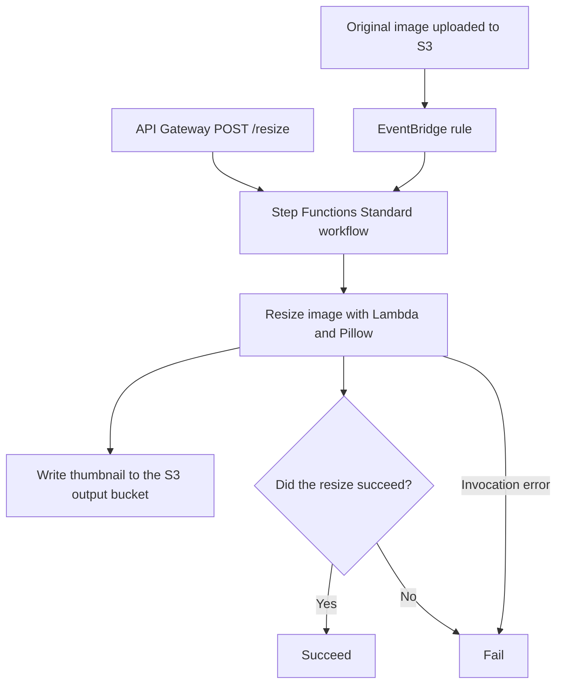

# CCMP-200 Serverless Image Processing Capstone

This project resizes JPEG and PNG images to fit within 200 × 200 pixels while keeping their aspect ratio. Amazon S3 stores the original and the thumbnail in separate buckets.

## Architecture



## Prerequisites and AWS settings

- An AWS account or course lab with access to S3, Lambda, Step Functions, API Gateway, EventBridge, and IAM.
- A Linux x86_64 Pillow layer for Python 3.15. The version is pinned in [requirements.txt](requirements.txt).
- AWS CloudShell for testing the deployed API with a signed request.
- A JPEG larger than 200 pixels on at least one side for the resize demo.

| Resource | Value |
|---|---|
| Region | US East (N. Virginia), us-east-1 |
| Originals bucket | ccmp200-arijit-originals-01 |
| Thumbnails bucket | ccmp200-arijit-thumbnails-01 |
| Lambda | capstone-resize-image |
| State machine | capstone-image-workflow |
| State machine ARN | arn:aws:states:us-east-1:213449029907:stateMachine:capstone-image-workflow |
| Regional REST API | `capstone-image-rest-api` |
| Deployed stage | `dev` |
| API endpoint | `https://5e4gedtlg4.execute-api.us-east-1.amazonaws.com/dev/resize` |

## 1. Deploy the Lambda function

1. Create two general purpose S3 buckets in the same region and keep Block Public Access enabled. If deploying in a different AWS account, choose unique bucket names and substitute them throughout these instructions.
2. In an empty directory, create the layer using the following command. Zip the python directory so python/ sits at the top of the archive.

```powershell
py -m pip install "Pillow==13.0.0" --platform manylinux_2_28_x86_64 --python-version 3.15 --implementation cp --abi cp315 --only-binary=:all: --target python
Compress-Archive -Path .\python -DestinationPath .\pillow-python315.zip -Force
```

3. In Lambda, publish the ZIP as a layer named capstone-pillow-python315. Choose Python 3.15 and x86_64. Attach it to capstone-resize-image.
4. Deploy [lambda_function.py](lambda_function.py) with handler lambda_function.lambda_handler. Set memory to 512 MB and timeout to 30 seconds. Set INPUT_BUCKET and OUTPUT_BUCKET to the original and thumbnail bucket names.
5. Give the Lambda execution role CloudWatch logging permissions, s3:GetObject on originals-bucket/*, s3:ListBucket on the originals bucket, and s3:PutObject on thumbnails-bucket/thumbnails/*. ListBucket lets S3 return a file-not-found error for an absent image.
6. Upload sample.jpg to the originals bucket. Run a Lambda test using the JSON in the next section and confirm the thumbnail appears at thumbnails/sample.jpg in the output bucket.

## 2. Deploy and test Step Functions

Create a Standard workflow named capstone-image-workflow using [state-machine.json](state-machine.json). If deploying to a different account or region, replace ResizeImage.Parameters.FunctionName with the ARN of the Lambda you deployed. Give the state machine execution role lambda:InvokeFunction for that function.

Run the state machine with this input.

```json
{
  "bucket": "ccmp200-arijit-originals-01",
  "key": "sample.jpg"
}
```

A successful execution follows ResizeImage → ResizeSuccessful → ImageProcessed. Run again with missing.jpg, using a filename that does not exist. The expected path ends at ImageProcessingFailed.

## 3. Connect API Gateway

1. Create a Regional **REST API** named `capstone-image-rest-api` in N. Virginia. Create the `/resize` resource under `/`, then add a `POST` method to it.
2. Use an **AWS service** integration. Choose `us-east-1` and **Step Functions**, leave the subdomain blank, and set the integration HTTP method to `POST`. Select **Use action name** and enter `StartExecution`.
3. Use the ARN of `capstone-api-start-workflow-role` as the integration execution role. Its trust policy allows `apigateway.amazonaws.com` to assume it. Its permissions allow `states:StartExecution` on `capstone-image-workflow`.
4. In **Integration request → Edit**, set **Request body passthrough** to **Never** and add an `application/json` mapping template. It sends the workflow ARN and passes the request body as a JSON string.

```vtl
{
  "stateMachineArn": "arn:aws:states:us-east-1:213449029907:stateMachine:capstone-image-workflow",
  "input": "$util.escapeJavaScript($input.json('$')).replaceAll("\\'","'")"
}
```

5. In **Method request**, set authorization to `AWS_IAM`. Deploy the API to a stage named `dev`. The identity testing the deployed endpoint needs `execute-api:Invoke` for `POST /dev/resize`.

### Test the deployed API

Open AWS CloudShell in N. Virginia and run the command below. It signs the request with your current AWS session. If you redeploy to a different API, replace the URL with your stage's Invoke URL followed by `/resize`.

```bash
aws configure export-credentials --format process |
  jq -r '
    "user = " + ((.AccessKeyId + ":" + .SecretAccessKey) | @json),
    (if .SessionToken then
      "header = " + (("X-Amz-Security-Token: " + .SessionToken) | @json)
    else empty end)
  ' |
  curl --config - --silent --show-error --include \
    --aws-sigv4 'aws:amz:us-east-1:execute-api' \
    --header 'Content-Type: application/json' \
    --data '{"bucket":"ccmp200-arijit-originals-01","key":"sample.jpg"}' \
    'https://5e4gedtlg4.execute-api.us-east-1.amazonaws.com/dev/resize'
```

Look for HTTP 200 and an `executionArn` in the response body. Open that execution in Step Functions and check that it says **Succeeded**. In the thumbnails bucket, check for `thumbnails/sample.jpg`.

## 4. Process uploads automatically

1. On the originals bucket, open **Properties → Event notifications → Amazon EventBridge** and enable EventBridge. AWS notes that this setting can take around five minutes to take effect.
2. In EventBridge, create a rule called capstone-original-image-upload on the default event bus. Use this event pattern.

```json
{
  "source": ["aws.s3"],
  "detail-type": ["Object Created"],
  "detail": {
    "bucket": {
      "name": ["ccmp200-arijit-originals-01"]
    }
  }
}
```

3. Select **Step Functions state machine** as the target and choose capstone-image-workflow. Let EventBridge create a target execution role if your lab permits it. The role trusts events.amazonaws.com and needs states:StartExecution on this workflow.
4. In the target's input settings, choose **Input transformer** and enter the input paths and template below.

```json
{
  "bucket": "$.detail.bucket.name",
  "key": "$.detail.object.key"
}
```

```text
{"bucket": <bucket>, "key": <key>}
```

5. Save and enable the rule. Upload a fresh image named upload-demo.jpg to the originals bucket. Confirm a new Step Functions execution appears without manually starting it, and verify that thumbnails/upload-demo.jpg appears in the output bucket.

## Demo video

1. Show the two S3 buckets and upload a fresh JPEG to the originals bucket.
2. Show the automatic Step Functions execution reach ImageProcessed. Open the thumbnail and show the dimensions.
3. Send POST /resize and show the returned execution ARN. Match it to the new successful Step Functions execution.
4. Show the missing-image test reach ImageProcessingFailed.

Submit the repository link and the short video. For a private repository, verify the instructor can open it before submitting.
